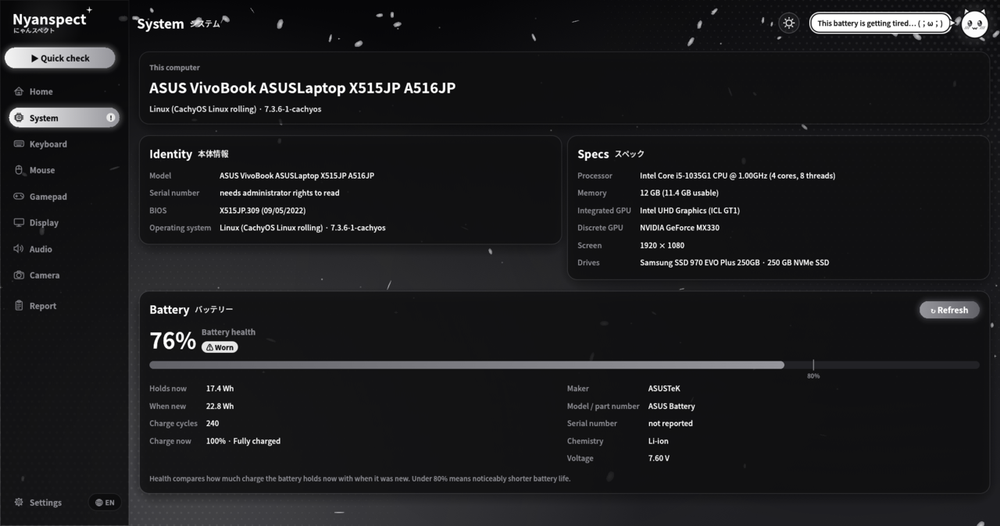
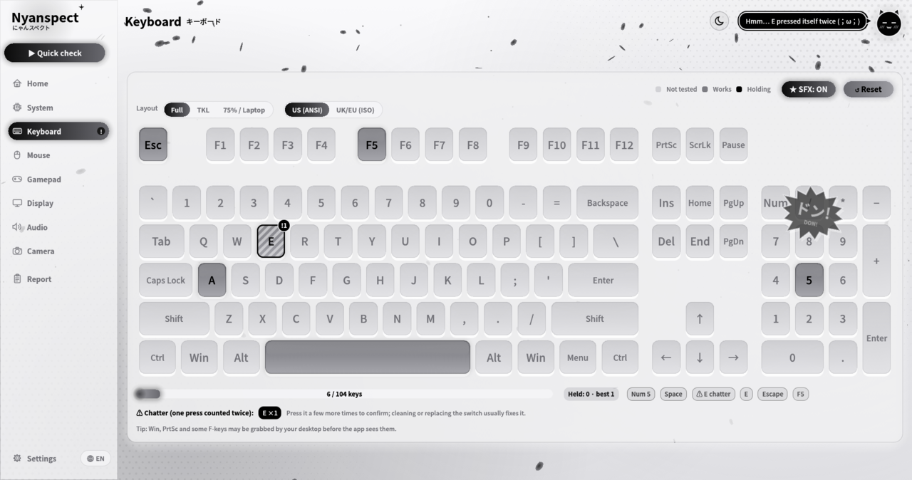

<p align="center"></p>

<h1 align="center">Nyanspect <sub>にゃんスペクト</sub></h1>
<p align="center"><a href="https://github.com/jerryl-creator/nyanspect/actions/workflows/build-windows.yml"></a></p>
<p align="center"><i>nyan</i> (meow) + <i>inspect</i>: a small, anime-styled hardware tester for checking a computer before you buy, sell or repair it:<br><b>keyboard</b>, <b>mouse</b>, <b>controller</b>, <b>screen</b>, <b>speakers</b>, <b>microphone</b>, <b>webcam</b> and <b>battery</b>.<br>Written in Rust with <a href="https://github.com/emilk/egui">egui</a>. Runs on Windows 10/11 and Linux, in English, 简体中文, Bahasa Melayu and 日本語.</p>


<p align="center">
  
  
</p>

## Features

Start with the **▶ Quick check**: it walks through every test one step at a time and ends at a report.
Or open any test from the sidebar. Your settings are remembered between launches, and nothing you test ever leaves the computer.

**🖥 System**
- The computer's **model**, **serial number** (with a copy button) and **BIOS** version, read from the firmware
- **Processor**, **memory**, **integrated and discrete GPUs**, screen and **drives** (NVMe / SSD / HDD)
- **Battery health**: how much charge the battery holds now compared with when it was new, with charge cycles. Under 80% is flagged as worn
- The battery's maker, model / part number, serial number, chemistry, voltage, temperature, charge or drain power, time left and charge limit (when the battery reports them)

**⌨ Keyboard**
- Pick your keyboard: **Full** (with numpad), **TKL** (no numpad) or **75% / Laptop**, in **US (ANSI)** or **UK/EU (ISO)** style. Left/right Shift, Ctrl, Alt and Win are shown separately
- **Chatter detection**: flags a worn or dirty switch that registers one press as two
- **Rollover**: shows how many keys register at once (ghosting check)
- Manga sound effects on every key press: a pop-up word (ドーン!! for Space, 決定! for Enter, …) plus a matching sound

**🖱 Mouse & touchpad**
- Left, middle, right and the Back/Forward side buttons, scrolling in all four directions, and double-click
- **Slow-click test**: click slowly and Nyanspect shows the shortest gap between clicks per button. A healthy switch never goes under 50 ms; a worn one sneaks in unwanted double-clicks
- A guided **double-click problem test**, and a drawing area that shows jumps or dead spots on a touchpad

**🎮 Gamepad**
- The layout follows your controller: **Xbox**, **PlayStation** (PS3, PS4, PS5) or **Nintendo**, with the right button names and symbols
- Every button, D-pad direction and analog trigger, plus both sticks with a live position dot
- **Stick drift test**: let go of both sticks and Nyanspect measures where each one rests, on a zoomed plot. Under 5% off-centre is normal; over 10% means games may move on their own
- **Motion sensors (6-axis)** on PlayStation 4 / 5 controllers: live accelerometer and gyroscope readings, a tilt bubble, and checks for tilting and turning around each axis
- **Vibration test** for the strong and weak motors separately

**★ Display**
- **Dead pixels**: fullscreen solid colours for dead (always black) and stuck pixels
- **Backlight & uniformity**: black and dark grays for backlight bleed and clouding
- **Gradients**: smooth ramps that show banding
- **Click to mark** a bad spot; its exact pixel position goes in the report

**🔊 Audio**
- One button per speaker (stereo up to 7.1), left/right alternate, and a 20 Hz – 20 kHz sweep, with a **"Heard it?" Yes/No checklist** per speaker
- **Microphone**: live level meter, waveform, and "record 3 s and play back". The mic only turns on when you press Start, and recordings are never saved

**📷 Camera**
- Live picture with the resolution, format and measured frame rate, and a warning when the picture stays dark (lens covered or privacy shutter closed)
- The camera is only on while the Camera tab is open and you've pressed Start. Nothing is recorded or sent anywhere

**📋 Report**
- A summary of every test (Pass / Issue found / In progress / Not tested) with the details
- **Copy**, **Save as text** or **Save as image** (saved to your Downloads folder), handy when buying a used laptop or making a warranty claim

**⚙ Settings**
- **Language**: English, 简体中文, Bahasa Melayu or 日本語 (follows your system language until you pick one; also in the 🌐 button)
- **Theme**: Dark, Light (black ink on white paper, like a manga page; easier to read in bright rooms) or Match system. The ☀ / ☾ button in the top bar switches with one click
- **Text size**, keyboard sound effects, reduce motion, and **Clear all results** before testing the next computer

## Download

Ready-made builds are attached to the [Releases](../../releases) page. **No Rust or other tools needed**:
download the file for your system and run it. Nyanspect supports Windows 10/11 and Linux; macOS isn't supported.

| Your system | Download |
|---|---|
| Windows, Intel or AMD processor (most PCs) | `nyanspect.exe` |
| Windows, Snapdragon / ARM processor (e.g. Snapdragon X laptops) | `nyanspect-arm64.exe` |
| Linux, 64-bit Intel or AMD (x86_64) | `nyanspect-linux-x86_64.tar.gz` |
| Linux, 64-bit ARM (e.g. Raspberry Pi 4/5 with a 64-bit OS, ARM laptops) | `nyanspect-linux-arm64.tar.gz` |

### Windows

Double-click the `.exe`; there's no installer. Not sure which one? Open **Settings → System → About** and check
*System type*: "x64-based" means `nyanspect.exe`, "ARM-based" means `nyanspect-arm64.exe`.
Windows may show a SmartScreen warning because the file isn't code-signed: choose **More info → Run anyway**.

### Linux

```bash
tar -xzf nyanspect-linux-x86_64.tar.gz    # or nyanspect-linux-arm64.tar.gz
cd nyanspect
./install.sh          # adds Nyanspect to your app menu (no sudo needed)
```

Or skip installing and run `./nyanspect` straight from the folder. To remove it later: `./install.sh --uninstall`.
Not sure which download? Run `uname -m`: `x86_64` means the x86_64 file, `aarch64` means the arm64 one.

It runs on Ubuntu 22.04 or newer, Debian 12+, Fedora, Arch and most other current distros, with Wayland or X11.
It needs the ALSA sound library (`libasound`) and `libudev` (for gamepads), which desktop systems already have.
Webcams work through the kernel's standard video driver (V4L2), so any USB or built-in webcam should show up.

## Building from source (developers only)

> **Just want to use Nyanspect?** You don't need anything in this section: grab a ready-made download above.
> Rust is only needed to build Nyanspect yourself, for example to change the code.

### 1. Install Rust with rustup

Building Nyanspect needs **rustup**, the official Rust installer. Use it even if your Linux distro has its own
`rust` package: only rustup can add the Windows target needed to build `nyanspect.exe`.

**Linux**

```bash
curl --proto '=https' --tlsv1.2 -sSf https://sh.rustup.rs | sh
```

Then open a new terminal (or run `source "$HOME/.cargo/env"`). On Arch you can use `sudo pacman -S rustup` instead,
then run `rustup default stable`.

**Windows**

Download and run `rustup-init.exe` from [rustup.rs](https://rustup.rs). If it asks, let it install the
Visual Studio C++ Build Tools: Rust needs them on Windows.

Check that it worked:

```bash
rustc --version
cargo --version
```

### 2. Build for Linux

Install the ALSA (sound) and udev (gamepads) development headers, plus clang (the webcam code is built against the kernel's camera headers):

| Distro | Command |
|---|---|
| Arch | `sudo pacman -S alsa-lib systemd-libs clang` |
| Debian / Ubuntu | `sudo apt install libasound2-dev libudev-dev libclang-dev pkg-config` |
| Fedora | `sudo dnf install alsa-lib-devel systemd-devel clang-devel` |

```bash
cargo build --release
./target/release/nyanspect
```

To make the same `.tar.gz` package as the releases: `./package-linux.sh` (writes `dist/nyanspect-linux-<cpu>.tar.gz`
for the machine you run it on: `x86_64` or `arm64`).

### 3. Build the Windows `.exe` from Linux

Add the Windows target and install the MinGW-w64 cross compiler:

```bash
rustup target add x86_64-pc-windows-gnu
```

| Distro | Command |
|---|---|
| Arch | `sudo pacman -S mingw-w64-gcc` |
| Debian / Ubuntu | `sudo apt install gcc-mingw-w64-x86-64` |
| Fedora | `sudo dnf install mingw64-gcc` |

```bash
./build-windows.sh        # writes dist/nyanspect.exe
```

The script checks for rustup, the Windows target and MinGW first, and tells you how to install anything that's missing.

On Windows itself, `cargo build --release` should also work and writes `target\release\nyanspect.exe`
(this route isn't covered by CI).

### Automatic builds (GitHub Actions)

[`.github/workflows/build-windows.yml`](.github/workflows/build-windows.yml) builds all four downloads on every push and
pull request: Windows x64 by running `build-windows.sh` on Linux, Windows ARM64 natively on a Windows 11 ARM machine,
and Linux x86_64 and ARM64 by running the tests and `package-linux.sh` natively on Ubuntu 22.04 (Intel and ARM machines).
Download them from the run's **Artifacts** section (`nyanspect-windows`, `nyanspect-windows-arm64`,
`nyanspect-linux-x86_64`, `nyanspect-linux-arm64`). Pushing a version tag also attaches all of them to that release:

```bash
git tag v2.0.0
git push origin v2.0.0
```

## Graphics compatibility

Nyanspect prefers the integrated GPU (it doesn't need a discrete one, which saves battery on laptops) and uses DirectX 12 on Windows or Vulkan on Linux.
If that fails it restarts itself with OpenGL (`--opengl`), and if there's no usable GPU driver it falls back to a software renderer.
Startup errors are shown in a dialog and saved to `nyanspect-error.log` in the temp folder.

## Notes

- `vendor/egui-winit` is a lightly patched copy of [egui-winit](https://github.com/emilk/egui) 0.37 (MIT OR Apache-2.0), used so the app can tell numpad keys apart from the main keys. See [vendor/egui-winit/NYANSPECT_PATCH.md](vendor/egui-winit/NYANSPECT_PATCH.md).
- `vendor/nokhwa-bindings-windows` is a patched copy of [nokhwa](https://github.com/l1npengtul/nokhwa)'s Windows camera code (Apache-2.0), so webcams whose frame rate isn't a whole number (like 29.97 fps) work. See [vendor/nokhwa-bindings-windows/NYANSPECT_PATCH.md](vendor/nokhwa-bindings-windows/NYANSPECT_PATCH.md).
- Chinese and Japanese text uses a font already on the system (Noto Sans CJK on Linux; Microsoft YaHei, Yu Gothic or Meiryo on Windows). Without one, the small Japanese subtitles are hidden; pick English or Malay if Chinese or Japanese text can't be shown.
- The serial number needs administrator rights to read on Linux; on Windows it's read normally.

## License

Nyanspect is released under the [MIT License](LICENSE).
The patched copies in `vendor/` keep their original licenses: MIT OR Apache-2.0 for egui-winit, Apache-2.0 for nokhwa-bindings-windows.
