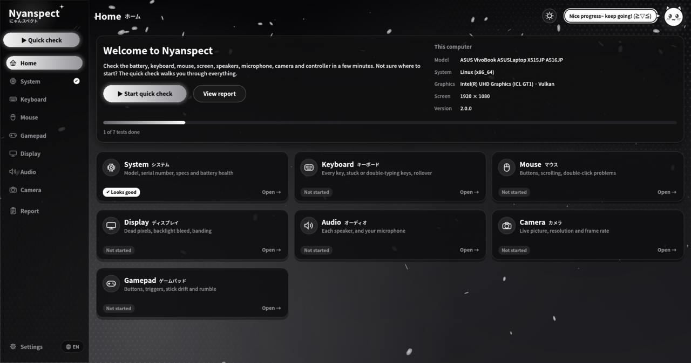

<p align="center"></p>

<h1 align="center">HW Test</h1>
<p align="center"><a href="https://github.com/jerryl-creator/hwtest/actions/workflows/build-windows.yml"></a></p>
<p align="center">A small, anime-styled hardware tester for <b>keyboards</b>, <b>dead pixels</b> and <b>speakers</b>.<br>Written in Rust with <a href="https://github.com/emilk/egui">egui</a>. Runs on Windows 10/11 and Linux.</p>



## Features

**⌨ Keyboard**
- Full-size Windows layout (104 keys), including the numpad, with left/right Shift, Ctrl, Alt and Win shown separately
- Keys turn silver once they work and glow white while held; a progress bar counts tested keys
- Manga sound effects on every key press: a pop-up word (ドーン!! for Space, 決定! for Enter, …) plus a matching sound (a boom, a chime, a zap, …). Turn both off with the SFX button

**★ Dead pixels**
- Fullscreen black, white, red, green, blue, cyan, magenta, yellow and gray
- Click, Space or → for the next colour, ← for the previous, Esc to exit; optional auto-cycle
- Optional stuck-pixel "fixer" (rapid RGB flashing, with a photosensitivity warning)

**♫ Speakers**
- One button per output channel (stereo, 4.0, 5.1, 7.1), plus all channels, left/right alternate, and a 20 Hz – 20 kHz sweep
- Sine, square or white noise, with adjustable frequency and volume, and a live waveform

## Download

Windows builds are attached to the [Releases](../../releases) page. Each is a single file with no installer:

| Your PC | Download |
|---|---|
| Intel or AMD processor (most PCs) | `hwtest.exe` |
| Snapdragon / ARM processor (Windows on ARM, e.g. Snapdragon X laptops) | `hwtest-arm64.exe` |

Not sure? Open **Settings → System → About** and check *System type*: "x64-based" means `hwtest.exe`, "ARM-based" means `hwtest-arm64.exe`.
Windows may show a SmartScreen warning because the file isn't code-signed: choose **More info → Run anyway**.

## Building

### 1. Install Rust with rustup (required)

HW Test supports **Windows 10/11 and Linux**. macOS isn't supported or tested.

HW Test is built with **rustup**, the official Rust installer. Use it even if your Linux distro has its own
`rust` package: only rustup can add the Windows target needed to build `hwtest.exe`.

**Linux**

```bash
curl --proto '=https' --tlsv1.2 -sSf https://sh.rustup.rs | sh
```

Then open a new terminal (or run `source "$HOME/.cargo/env"`). On Arch you can use `sudo pacman -S rustup` instead,
then run `rustup default stable`.

**Windows**

Download and run `rustup-init.exe` from [rustup.rs](https://rustup.rs). If it asks, let it install the
Visual Studio C++ Build Tools: Rust needs them on Windows.

Check that it worked:

```bash
rustc --version
cargo --version
```

### 2. Build for Linux

Install the ALSA development headers (used for sound):

| Distro | Command |
|---|---|
| Arch | `sudo pacman -S alsa-lib` |
| Debian / Ubuntu | `sudo apt install libasound2-dev pkg-config` |
| Fedora | `sudo dnf install alsa-lib-devel` |

```bash
cargo build --release
./target/release/hwtest
```

### 3. Build the Windows `.exe` from Linux

Add the Windows target and install the MinGW-w64 cross compiler:

```bash
rustup target add x86_64-pc-windows-gnu
```

| Distro | Command |
|---|---|
| Arch | `sudo pacman -S mingw-w64-gcc` |
| Debian / Ubuntu | `sudo apt install gcc-mingw-w64-x86-64` |
| Fedora | `sudo dnf install mingw64-gcc` |

```bash
./build-windows.sh        # writes dist/hwtest.exe
```

The script checks for rustup, the Windows target and MinGW first, and tells you how to install anything that's missing.

On Windows itself, `cargo build --release` should also work and writes `target\release\hwtest.exe`
(this route isn't covered by CI).

### Automatic builds (GitHub Actions)

[`.github/workflows/build-windows.yml`](.github/workflows/build-windows.yml) builds both Windows versions on every push and
pull request: x64 by running `build-windows.sh` on Linux, and ARM64 natively on a Windows 11 ARM machine.
Download them from the run's **Artifacts** section (`hwtest-windows` and `hwtest-windows-arm64`).
Pushing a version tag also attaches both exes to that release:

```bash
git tag v1.1.0
git push origin v1.1.0
```

## Graphics compatibility

HW Test prefers the integrated GPU (it doesn't need a discrete one, which saves battery on laptops) and uses DirectX 12 on Windows or Vulkan on Linux.
If that fails it restarts itself with OpenGL (`--opengl`), and if there's no usable GPU driver it falls back to a software renderer.
Startup errors are shown in a dialog and saved to `hwtest-error.log` in the temp folder.

## Notes

- `vendor/egui-winit` is a lightly patched copy of [egui-winit](https://github.com/emilk/egui) 0.37 (MIT OR Apache-2.0), used so the app can tell numpad keys apart from the main keys. See [vendor/egui-winit/HWTEST_PATCH.md](vendor/egui-winit/HWTEST_PATCH.md).
- Japanese labels use a font already on the system (Noto Sans CJK on Linux, Yu Gothic or Meiryo on Windows). Without one, they are simply hidden.

## License

HW Test is released under the [MIT License](LICENSE).
The patched copy of egui-winit in `vendor/egui-winit` keeps its original MIT OR Apache-2.0 license.
